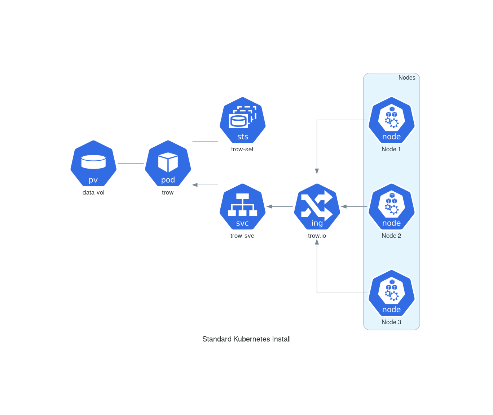
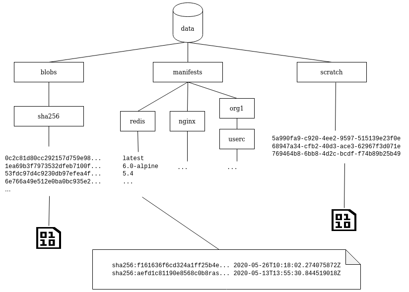

# Trow Architecture

Trow is a single Rust crate organised in strict layers. Each layer may only depend on the ones
below it:

```
routes     axum handlers, extractors, response rendering
   |
services   business rules and orchestration
   |
repositories (SQLite)      file_storage (blobs and in-progress uploads)
   |
utils      digests, manifest parsing, temporary files
```

Note:

 1. All interaction with clients (normally the Docker Daemon, but also podman, CI/CD tools etc) is
    currently via a RESTful (ish) API interface. The interface is defined by the OCI Distribution
    spec, although Trow adds a few features of its own.

 2. Trow saves container image data to file. Currently, we don't have any options to use different
    storage like S3. This still allows a considerable deal of flexibility as it can be backed by
    multiple volume types, but at the same time we avoid the complexity of handling the error states
    of remote storage such as S3.

## Layering rules

`ci/check-layering.sh` enforces the rules below in CI. `#[cfg(test)]` modules are excluded, but the
spirit applies to tests as well.

| Layer | Lives in | May depend on | Must not |
| --- | --- | --- | --- |
| Routes | `src/routes/` | services, its own extractors and response types | run SQL, touch `repositories` or `file_storage` |
| Services | `src/services/` | repositories, `file_storage`, utils | import `axum`/`hyper`, return HTTP types |
| Repositories | `src/repositories/` | utils, `sqlx` | import services or routes |
| File storage | `src/file_storage.rs` | utils | import services or routes |
| Utils | `src/utils/` | nothing above it | import services, repositories or routes |

Other consequences of the rules:

 - **All SQL lives in `src/repositories/`.** It is the only module allowed to call `sqlx::query!`,
   and `ci/check-layering.sh` enforces that for tests as well as production code. Anything a route or
   a test needs to read or seed goes through a repository method or a fixture in
   `src/test_utilities.rs` (unit tests) / `tests/common/mod.rs` (integration tests). Those fixtures
   are thin wrappers over repository methods, so a test never holds a database pool and the same
   query cannot drift between production and test code. Seeding helpers that need a specific
   timestamp (GC staleness, upload age) take an age in seconds and let SQLite compute the value
   against its own clock, which is what the cutoff queries compare against.
 - **Services are transport agnostic.** They take `bytes::Bytes` or a byte stream, never
   `axum::body::Body`, and return plain structs. HTTP bodies, headers and status codes are decided in
   `src/routes/response/`.
 - **Error mapping happens once.** Services return `services::Error`; `Error::kind()` classifies it as
   a transport-neutral `ErrorKind`, and `src/routes/response/errors.rs` turns that into an OCI error
   code. Routes never match on storage or database error variants.
 - **Business rules have one home.** For example the rule that repositories starting with `f/` are
   read-only lives in `services::reference::ensure_writable`, not in each handler.
 - **Composition happens in one place.** `TrowConfig::build_server_state` builds `Repositories`,
   `FileStorage` and `Services`; `TrowServerState` then carries `config` plus the `Services` bundle.
   Services never construct each other outside `services::Services::new`.

Trow is implemented in [Rust](https://www.rust-lang.org/).

## Typical Kubernetes Deployment

The helm install will result in a deployment like this:



Trow data is backed to a volume, for example Google Persistent Disk. A
[StatefulSet](https://kubernetes.io/docs/concepts/workloads/controllers/statefulset/) rather than a
Deployment is used. This is required to handle updating Trow and reattaching the volume correctly.
All clients, including Kubernetes Nodes themselves connect to the registry via the Ingress. This

## Upload/Download Tracking and File Layout

This diagram shows how files are laid out in the data directory that represents the state of the
registry:



*Note: the diagram predates the move of metadata into SQLite — it still shows the old
`manifests/` and `sha256/` directories. The description below is current.*

Content lives on disk, metadata lives in SQLite (`trow.db`, in the data directory). To understand
how this is used, consider the process of uploading a new image:

 - The client begins by uploading all the layers that are not present in the registry. Each upload
   gets a UUID; its bytes accumulate in `uploads/<uuid>` while a row in the `blob_upload` table
   tracks the repository and the accepted offset.
 - When a layer upload completes, the digest is checked and the file is moved to `blobs/<digest>`
   and recorded in the `blob` table, with a `repo_blob_assoc` row tying it to the repository. All
   digests are SHA256 hashes of the content at the moment.
 - Once the layers are uploaded, the manifest is uploaded in the same manner: validated against the
   blobs already associated with the repository, then stored in `blobs/<digest>` and recorded in the
   `manifest` table.
 - A tag is a row in the `tag` table mapping `(repo, tag)` to a manifest digest. Manifests are looked
   up through `manifest_repository`/`tag_repository`; the bytes are read back from `blobs/`.

So this means:

 - Files in the `blobs` directory represent not just image layers, but also manifests and config
   data referred to from manifests. They are content addressed and shared between repositories.
 - The files in `uploads` _are not_ digests. They are UUIDs used for temporary tracking of uploads,
   and are cleaned up by the garbage collector if abandoned.
 - Garbage collection is incremental rather than "pause-the-world": `services::gc_service` runs on a
   timer, deleting abandoned uploads and, when a `registry_proxies.max_size` limit is configured,
   aged proxied images.
